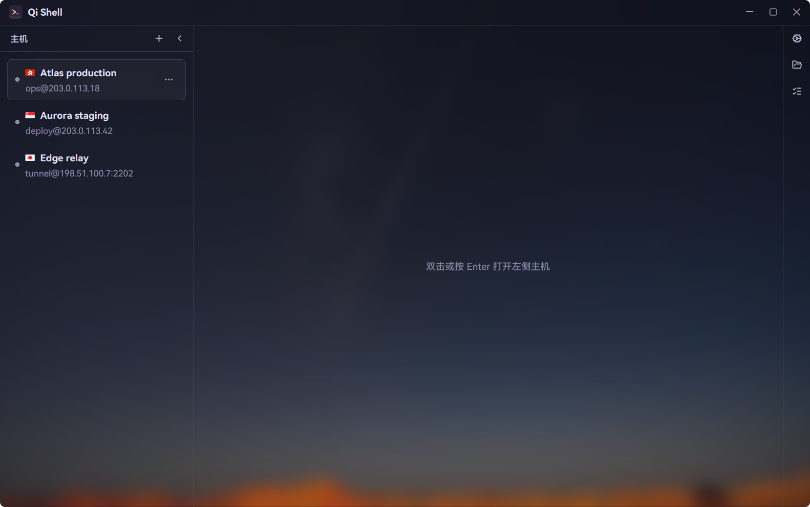

# Qi Shell

SSH 工作区桌面应用。Rust + [gpui-kit](https://gpui-kit.com)（GPUI）实现，主机管理、SSH 登录、终端与 SFTP 都是真实实现，数据全部放在程序旁边，整个文件夹拷走即可迁移。



## 功能

**主机与连接**

- 主机列表：平铺、拖动排序、右键菜单、新建 / 编辑 / 删除、复制地址；名称里的国旗 emoji 画成真实旗帜。
- 真实登录（`russh`）：密码与私钥两种认证，首次连接确认主机密钥、密钥变化时警告；应用自带 `known_hosts`，不碰 `~/.ssh`。
- 「测试连接」是真登录，失败原因来自真实错误链。

**终端**

- `alacritty_terminal` 引擎，`vim` / `htop` 等全屏程序可用；回滚 10000 行。
- 查找（Ctrl+F / F3）、右键复制粘贴、复制 / 粘贴 / 清屏，断线后按 Enter 重连。
- 连接栏提供断开 / 重连，状态栏显示连接状态、延迟与 UTF-8。

**SFTP**

- 右侧栏打开 SFTP 标签，本地与远程双栏，各自独立连接、复用主机凭据。
- 拖放上传 / 下载，传输队列显示进度、速度与剩余时间，支持暂停、继续、取消、重试。
- 大文件走 `.filepart` 断点续传，同名文件可覆盖或跳过，并发数在设置里调。
- 双击进入目录、表头排序、拖动列宽、新建文件夹 / 文件、重命名、删除（本地进回收站，远程永久删除）。

**其它**

- 标签、命令片段、设置四页（外观 / 终端 / 连接 / SFTP）、Toast 提示与完整快捷键。
- 壁纸与玻璃面板：壁纸可选预模糊，面板、浮层、弹窗用半透明深色叠在壁纸上，对比度有测试守着。

## 运行

```bash
cargo run
```

工具链固定在 `rust-toolchain.toml`（Rust 1.98.1），`rustup` 会在首次使用时自动装上。首次构建要编译整个 GPUI 栈，耗时较长。

## 数据与便携

所有数据默认放在 exe 同级的 `data\`：

```
Qi Shell/
├─ qishell.exe
└─ data/
   ├─ qishell.db      主机（SQLite，WAL）
   ├─ settings.json   设置
   ├─ known_hosts     主机密钥信任
   ├─ secrets.dat     密码与私钥口令（AES-256-GCM）
   ├─ secret.key      secrets.dat 的加密密钥
   ├─ snippets.json   命令片段
   ├─ keys/           私钥
   └─ wallpaper-*     壁纸（以及 wallpaper-cache/ 里的模糊结果）
```

- **迁移**：退出后复制整个文件夹到新机器即可，无需安装。数据里不写本机绝对路径，私钥与壁纸都存相对路径。
- `QISHELL_DATA_DIR` 可指定别处；装在不可写目录（如 Program Files）时自动退回 `%APPDATA%\Qi Shell`。
- 开发时 `cargo run` 的数据目录是 `target/debug/data`。
- **安全提示**：`secret.key` 与密文在同一个文件夹，能挡住随手翻文件，挡不住拿到整个文件夹的人。更看重安全就删掉这两个文件，之后每次连接时询问密码。

## 测试

```bash
cargo test
cargo clippy --all-targets -- -D warnings
cargo fmt --check
```

`tests/ui/` 用无头窗口驱动真实点击、输入与注入的假终端，覆盖启动状态、主机增删改、打开标签、主机密钥确认与认证询问、对话框焦点顺序等流程。`tests/ui_standards.rs` 是 UI 规范守卫：视图层出现裸色值、裸字体族或直接引用调色板常量就失败，规范见 [`docs/UI-STANDARDS.md`](docs/UI-STANDARDS.md)。

`src/host/`、`src/secrets/`、`src/ssh/` 另有单元测试（字段校验、数据库往返、schema 不含秘密列、`known_hosts` 损坏拦截、终端按键编码）。真实服务器联调用 `examples/live_ssh.rs`，凭据只从环境变量读：

```bash
QISHELL_SSH_ADDRESS=主机 QISHELL_SSH_PORT=22 QISHELL_SSH_USER=用户 QISHELL_SSH_PASSWORD=密码 cargo run --example live_ssh
```

## 打包

```bash
cargo build --release
```

```bash
scripts/package_portable.bat
```

产物在 `dist/QiShell-portable/`：`qishell.exe` 与 `LICENSE.txt`。包里故意不预置 `data\`，免得把开发机的数据库与密码一起发出去，第一次启动会自己建。E 盘空间紧张时可用 `CARGO_TARGET_DIR` 指到别的盘。

## 目录

```
src/
├─ app.rs / app/paths.rs   启动、窗口、快捷键、数据目录
├─ theme.rs                设计令牌
├─ model.rs                标签与设置模型
├─ connection.rs           连接问答协议与延迟
├─ host/                   主机模型、SQLite、内存 store、登录快照
├─ ssh/                    SSH 连接、known_hosts、测试连接、终端传输
├─ secrets/                本地加密秘密库
├─ terminal/               alacritty 引擎、传输、网格视图、字体与配色
├─ sftp/                   本地与远程文件系统、传输
├─ snippets/               命令片段
├─ workspace/              标题栏、主机栏、连接栏、标签栏、状态栏、壁纸
├─ settings/               设置模型、JSON 存储与四个页面
├─ dialogs/                主机表单、连接问答、SFTP 冲突
└─ components/             通用小部件
assets/                    字体、国旗、应用图标
scripts/                   打包、截图与字符清单脚本
docs/                      开发计划、UI 规范、外观参数
```

## 已知限制

- 未做：本地终端、端口转发、ZMODEM、主机分组与搜索、窄屏布局、快捷键编辑器。
- 终端快捷键目前固定为 Ctrl+Shift+C / Ctrl+Shift+V / Ctrl+Shift+A / Ctrl+F / F3。
- GPUI 不支持逐面板背景模糊，模糊只作用于壁纸。
- 用户输入的生僻字会回退到系统字体。
- 系统通知（OSC 9 / 777、响铃）只显示为应用内提示。

## 许可

代码以 GPL-3.0-only 发布，见 [`LICENSE`](LICENSE)。随仓库分发的字体、国旗图片等第三方素材各有许可，见 [`THIRD-PARTY-NOTICES.md`](THIRD-PARTY-NOTICES.md)。
